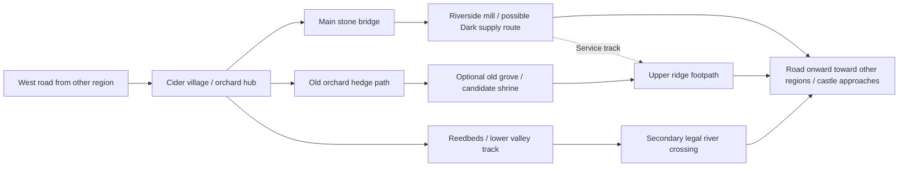

# Orchard Vale: "The Last Fruit" | Region prototype 01

**Status:** **Design proposal for evaluation, NOT canon.** Created 2026-11-12. No new gameplay mechanics or fixed world features are approved here.

**Purpose:** Test whether the approved kingdom theme (D-092/D-093) and guided procedural geography (D-084 through D-091) can produce a place with believable life, memorable fairytale magic, strong 4v4 choices and robust per-seed variety. This is a *region archetype*, not an approved named province or a mandatory map zone.

## In one sentence

A warm river valley of orchards and cider-making villages where families leave the last fruit on every tree for an unseen visitor, while a strategic river crossing and old grove draw pressure from both Light explorers and Dark commanders.

### Why this specific example?

It deliberately starts with a region worth visiting even **without** monsters. Its beauty comes from human activity: orchard terraces, cart tracks, harvest gatherings, apple storage, an old mill and water. The old magic is present in the culture but not explained. When the Dark side takes interest in the bridge and grove, the region becomes contested **without losing its identity**.

**What it tests:** believable inhabited life, everyday coexistence with older magic, a clear visual silhouette at elevated 3D camera distance, Dark logistics versus Light infiltration, a possible shrine progression opportunity and three viable travel corridors.

## Artifact 1: Environmental concept and identity sheet

### Geography and livelihood

**Proposed physical logic:** A river divides the lower valley and powers a mill. Productive slopes and alluvial soil support orchards; hedges and windbreaks divide the plots; woodland remains on higher or rockier ground. The main cart-road follows the gentlest grade to the market/bridge. An older, narrow path skirts the oldest trees because the villagers historically preferred to avoid disturbing that grove.

- **West side:** terraced orchards, pale plaster-and-timber houses, cider press, seed sheds, small garden walls, worn farm tracks.
- **River corridor:** stone bridge, watermill, reeds, wet ground and conspicuous long sight lines across open bank.
- **High orchard and coppice:** winding narrow track, dark hedge tunnels, twisted mature trees, old boundary markers and an optional sacred clearing.
- **Southern lowland:** seasonal marsh/ford or another credible secondary crossing, with slow exposed patches offset by reed cover. If a seed lacks a real legal second crossing, its regional layout must be reconsidered.

**Causal consistency:** the mill must touch a viable watercourse; trade and farmland must connect to public roads; orchard plots should occupy plausible ground; any water crossings must correspond to actual traversal geometry. The road's detour around an older grove should look historically deliberate, not algorithmically arbitrary.

### What the people believe (sample community identity)

The old practice is called **"the last fruit"**: at the end of the harvest, households leave a single apple on certain trees. Some say it is thanks to whatever first taught the trees to bear. Others say taking the final fruit invites a guest who never knocks.

The game should not immediately explain which account is true. Small environmental evidence might include an untouched red apple after frost, empty places set at a harvest table, or a child's ribbon tied below a branch. None of these imply a harvest curse, supernatural NPC behavior or a player reward without further design.

**Regional variation even in this one archetype:** some hamlets practice the custom casually; some are strictly observant; newer merchants might mock it. D-093 forbids turning "orchard biome" into a universally accepting religion or attitude.

### The old world is not the Dark Lord

The oldest trees predate the orchards and settlements. The shrine-like clearing (if present in the seed) feels strange independently of corruption. It might contain boundary stones, a hollow root or a quiet spring. This is *an older magical presence*, not automatically a Dark Energy source.

**Current Dark pressure, conditional to match state:** a Dark commander may find the bridge/mill a useful guarded route or supply site. A nearby major landmark may be corrupted, reclaimed or contested under existing rules. Civilian structures and customs remain recognizable. Do not presume dynamic bark growth, weather shifts, enemy possession, NPC flight or a new curse system.

### Camera-first visual language

| Layer | Proposed art direction | What it communicates |
| --- | --- | --- |
| Distant view | Long pale orchard terraces between dark wooded hills; a river ribbon and irregular roof cluster | A working valley, not random meadow props |
| Mid-range | Cream limewash, deep timber frames, muted brick-red roofs, cider barrels, dry stone walls, hedges and waterwheel | Trade, harvest, domestic history |
| Older-magic cues | Distinctive trees with asymmetrical roots, weathered boundary stone shapes, rare saturated fruit, subtle stillness at old grove | Something older without automatic evil coding |
| Dark-pressure cues | Sharply legible temporary barricades, guarded supply carts, altered route access, corruption-site identity using approved assets | Current strategic threat, not uniformly black environment |
| Traversal readability | Clear public cart-road, narrow hedge gaps, silhouettes against open banks, legitimate opaque hedge/stone cover | Players understand travel, danger and LOS |

**Color/contrast direction (proposed):** ochre wheat, moss-green leaves, cream plaster, blue-grey water and warm amber windows. Reserve deep violet/charcoal, harsh desaturation or unnatural illumination for targeted circumstances if later art direction approves them. Ensure readable silhouettes at actual camera height. No photorealistic clutter and no copied Warcraft assets.

**Sound direction (proposed, not implemented):** distant waterwheel rhythm, birds, loose cart fittings, wind through hedges, faint seasonal village ambience. Use distinct interruption/absence of sound near sacred places, without making absence itself a tracking mechanic. Dark patrol sounds should respect actual distance and occlusion rules.

### Local cultural contradictions (intentional)

- A cheerful busy cider press can stand within hearing range of a grove no one walks through after dark.
- A miller can depend on a river and dismiss the old stories about it.
- Children might know a "forbidden" hedge shortcut that a visiting merchant does not.
- Villagers can resent Dark roadblocks without necessarily understanding the Dark Lord's metaphysics.

These are opportunities for environmental storytelling, not scripted NPC behavior commitments.

## Artifact 2: Strategic geography and playable routes

The drawing is a **topological example**: it does not fix cardinal orientation, the castle's position, actual terrain sizes, number of sites, or mandatory named landmarks.

**The three corridor types** are deliberately different:
- **Main road + bridge:** simplest navigation and best army/logistics access; open lines of sight, clear chokepoint, easier to patrol.
- **High orchard hedge path:** harder to locate and navigate, more close cover and broken sight, possible spiritual discovery; risks being a dead end if generator/pathfinding doesn't validate it.
- **Lowland ford/reed route:** terrain and visibility tradeoffs; not necessarily always the stealthiest. Flooding and movement penalties are **not** yet approved mechanics.

These routes connect **outside** this sample region. They do not imply an instanced 3-lane arena or only three passages in the entire kingdom.

**Potential strategic landmarks (role labels, not permanent IDs):**
- Village/press: social/economic origin, resource and navigation cue; not an automatically approved shop, NPC quest system or safe zone.
- Bridge/mill: plausible Dark logistics patrol/holding target, relevant to Goblin strategic heists (D-072 to D-075). Specific shipment routing/effect still requires a gameplay spec.
- Old grove: optional major landmark and eligible Witch shrine **only when properly placed/configured**. A corrupted shrine must first be purified under D-052 before the Witch's one-time ritual can occur.
- Orchard storage/outbuildings: potential exploration/theft resources and short-range hiding geometry, without assuming every civilian is a valid theft victim.

### What the factions can do here

| Participant | Natural motivation | Interaction using confirmed loops | Still only a proposal |
| --- | --- | --- | --- |
| Goblin Outlaw | Cross unnoticed or investigate guarded supply | Sneak around patrols; identify a potential Dark logistics raid target; local detection/suspicion if a theft is legitimately witnessed | Specific depot contents, loot payouts, NPC targets, route alarms |
| Alchemist | Research region-specific plants and evidence | Investigate ingredient habitats and clues, without fixed recipes; some useful early opportunities must be accessible in overall match | Apple-based potion, guaranteed ingredient identity, named recipe |
| Exiled Knight | Strengthen the Light team while traversing a threatened settlement | Participate in meaningful world objectives/defense and shared resource gains under D-044 | Custom "save villagers" script or unique Valor payout here |
| Forest Witch | Follow strange spiritual disturbances | Sense possible shrine indirectly; focused sensing has detectable risk (D-053 to D-055); purify then perform unique ritual if the site is eligible | Guaranteed shrine location, automatic global pin or free power |
| Dark Heroes | Protect strategic road, scout alternative routes and contest landmark | Send patrols/armies to guard roads and supply infrastructure; owner sees live Scout vision, all Dark Heroes receive only confirmed time-stamped sightings (D-012) | Specific army composition, supply penalty values, universal town ownership |

The goal is **overlapping incentives**, not separate character minigame rooms. A Goblin disrupting the mill may divert Dark attention away from the Witch's grove. A Dark patrol may detect a Witch's *focused* sensing disturbance without automatically knowing who or where she is. The Alchemist might have to choose between gathering clues and crossing an exposed road.

## Artifact 3: Playable experience test (hypothetical sequence)

**Scenario:** The Witch and Alchemist are traveling across the valley. Dark Heroes intend to protect the bridge/mill corridor. Their exact positions are unknown. This is a *test script proposal*, not an assertion of implemented mechanics.

1. **Arrival / recognition.** From the west approach, players see the orchard terraces, the bridge, and village rooftops. The main road is obvious from their partially charted map. The sheltered orchard path is not.
2. **A local discovery.** The Alchemist notices habitat clues off the road. The Witch senses something old beyond the hedges. The secondary path is explored and becomes ordinary shared *team geography*, while the Witch's interpretation stays personal until shared (D-089/D-090).
3. **Meaningful fork.** The group can use the direct bridge, spend effort on the hidden orchard route or investigate the lowland crossing. The bridge may offer speed and clear navigation at a higher detection risk.
4. **Legitimate pressure.** A Scout patrol sees one player emerge into an open strip. Only its owner sees the live Scout view. The confirmed sighting generates a time-stamped Dark alert. The Light player breaks line of sight behind actual hedges/stone walls, drawing on the *already positive* M1 hunting design.
5. **Dark decision.** The Dark commander chooses whether to pursue the last-known location, protect the mill, or investigate the alternative crossing. They cannot magically know which path the Light player took after breaking contact.
6. **Optional objective.** If the old grove is a configured shrine and corrupted, the Light team may purify it. The Witch then has a *separate* vulnerable active ritual if she has not claimed that shrine's one-time progression (D-050/D-052/D-059). The party might instead continue the expedition and preserve stealth.
7. **Consequence and exit.** The players leave for another region through a real connected route. Any public road discovery updates their team map, while private hypothesis and unconfirmed intel remain private. Dark patrols and strategic site state persist under authoritative simulation.

**Pass condition:** the player meaningfully chose a route, understood the place's former/current character, and interacted with line-of-sight pursuit or an optional class opportunity without the map or fog-of-war cheating.

**Fail conditions:** every route collapses to a single bridge, foliage visually hides actors but does not block legal sight, the grove is just an obvious glowing quest beacon, the mill is a fake prop with no strategic potential, or the environment reads as generic medieval village with spooky clutter.

## Generator identity vs variation

**Stable *archetype* DNA (only if this concept is approved):**
- Productive orchard valley tied to water and plausible roads.
- Built evidence of livelihoods and old traditions.
- Small everyday magic customs with ambiguous older roots, separate from corruption.
- An easy public crossing and at least one nonidentical, viable alternative traversal path (prototype acceptance, not a global minimum).
- An important road/logistics opportunity plus optional discovery off the road.
- Distinct warmth-versus-uncertainty emotional contrast.

**Seed-variable dimensions:**
- Shape of river, ridge, orchard terraces and village distribution.
- Whether the public crossing is a bridge in the middle or nearer a regional edge; whether alternatives are a ford, footbridge or hillside detour, when actual movement allows.
- Whether this particular region has an eligible Witch shrine, where it lies, whether Dark corruption is present, and which landmark is contested.
- Local community differences in the practice and interpretation of the last-fruit tradition.
- Spatial relations among mill, village, shortcuts and Dark logistics.
- Weather/season/lighting only when supported by approved systems and proper readability tests.
- Resource opportunities from balanced biome/ingredient constraints, never fixed run-specific alchemical formulas.

**Anti-randomness constraints:** Never assign "old grove" in the river with no access; never put a mill on a dry ridge; do not put the only legal crossing inside mandatory permanent Dark lockdown; do not spawn resource promises on unreachable islands; avoid making the same hedge asset the only LOS obstacle everywhere; do not leak hidden shrine coordinates from a shared map.

## How to evaluate this proposal

### Review gate: visual identity

Prepare **one camera-accurate keyframe**, not a generic photoreal fantasy landscape, showing the full valley, settlement, mill/bridge, orchard pattern, and distant wooded grove. Then a closer crop showing *both* inhabited daily life and one subtle older-magic cue. Both must match actual target elevated strategy-camera readability, original silhouette language and art production budget.

No illustrations are embedded in this document. Visual references and frames are an explicit **next asset task**, not something already generated.

### Review gate: spatial/gameplay proof

Use a temporary debug layout with the core three approach types and test the M1 Scout's pursuit and losing sight while crossing the region. The presence of a village, path network and grove can initially be simple shapes with collisions and occluders. **The current 60×60m M1 forest crossing must not be overwritten** before this new proof passes.

### Review gate: variation proof

Make **three topology/theme variations** of this one archetype under the same cultural rules:
- **Tight valley:** village and bridge near one another, hedgerow terraces offer flanks.
- **Meandering river:** public route skirts several orchard clusters, lowland alternate has strong concealment at points.
- **Split hamlets:** settlements on both banks, old grove away from roads, indirect approach lengthens the expedition.

These are example variation tests; no fixed sizes or durations. Each variant must read as "a working orchard valley with old magic" but must have different route choices, route risks, and strategic responses.

## Review questions for the creator

1. Does the "last fruit" tradition feel distinctive and believable, or overly literal/cutesy?
2. Does a lived-in valley with **ambiguous** magic fit the emotional range, or should the supernatural be much more overt?
3. Does turning the mill/bridge into a potential operational target make the place feel consequential, or overly gamey?
4. Can the current visual identity express this with strong stylized silhouettes from the real camera?

**Unresolved before canon:** local folklore name and tone, civilian/NPC expressiveness, degree of supernatural proof, exact landmarks and services, access to crossing alternatives, dynamic Dark visual changes, and all numerical generator thresholds.

No code changes or irreversible generator decisions are authorized by this prototype. Approved global D-084 through D-093 rules remain controlling.
