# Orchard Vale item catalogue

GENERATED by `scripts/list-items.ts` from `src/shared/sim/items.ts` and `finds.ts`. Do not edit by hand.

All 100 items are playtest proposals (P-24 to P-26 in the [decision register](../decisions.md)). Icons are original vector stand-ins generated by `scripts/make-item-icons.mjs`; replace any file in `public/art/items` to give an item painted art. "Found" is the map area and coordinates of each find. Every Light Hero collects their own share.

## Weapons (27)

| | Item | Effect | Found |
| --- | --- | --- | --- |
|  | Dagger | Sweep · reach 2.1 m · 16 damage · 1.9/s | starting kit |
| 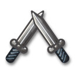 | Twin knives | Sweep · reach 1.8 m · 8 damage · 4.3/s | mid-west (-70, -6) |
| 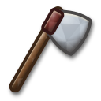 | Hatchet | Wide sweep · reach 2 m · 13 damage · 1.5/s | south-west (-40, 30) |
| 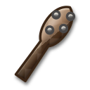 | Cudgel | Sweep · reach 2.2 m · 18 damage · 1.2/s · knocks back 1.8 m | north-centre (-10, -45) |
| 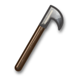 | Billhook | Thrust · reach 3.4 m · 24 damage · 1/s | mid-centre (2, 4) |
|  | Sling | Straight shot · range 9 m · 14 damage · 1/s | mid-west (-78, 12) |
|  | Hand crossbow | Straight shot · range 13 m · 30 damage · 0.5/s | mid-east (69, 13.2) |
|  | Cleaver | Sweep · reach 2.4 m · 20 damage · 1.4/s | starting kit |
| 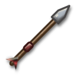 | Javelin | Straight shot · range 8 m · 18 damage · 0.8/s | starting kit |
|  | Rapier | Thrust · reach 2.9 m · 15 damage · 2.1/s · ×1.6 against the unhurt | south-east (83.5, 59.5) |
|  | Sickle | Sweep · reach 2 m · 11 damage · 1.7/s · bleeds 6/s for 4 s | south-west (-80.5, 60) |
| 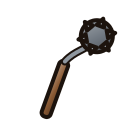 | Flail | Wide sweep · reach 2.5 m · 14 damage · 1/s · stuns for 0.6 s | north-west (-85, -59.5) |
| 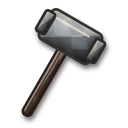 | Warhammer | Sweep · reach 2.3 m · 34 damage · 0.6/s · knocks back 2.6 m · stuns for 0.4 s | south-centre (-22, 58) |
| 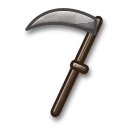 | Scythe | Wide sweep · reach 3.2 m · 19 damage · 0.8/s · bleeds 4/s for 3 s | north-east (81.5, -17.5) |
|  | Stiletto | Sweep · reach 1.7 m · 12 damage · 1.7/s · silent · ×2.5 from behind | south-west (-52, 58.5) |
| 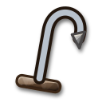 | Butcher hook | Sweep · reach 3 m · 13 damage · 1.1/s · pulls 1.6 m | south-centre (19.5, 58.5) |
|  | Pitchfork | Thrust · reach 3.1 m · 17 damage · 1.2/s · ×1.6 against monsters | south-east (53.5, 58.5) |
| 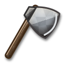 | Wood axe | Sweep · reach 2.2 m · 20 damage · 1/s · ×2 below 35% health | north-east (74.5, -61.5) |
|  | Whip | Straight shot · range 5 m · 9 damage · 1.5/s · slows for 2 s | south-west (-73, 37) |
|  | Longbow | Straight shot · range 16 m · 22 damage · 0.7/s | mid-east (54, -11) |
| 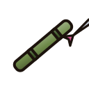 | Blowpipe | Straight shot · range 10 m · 5 damage · 1.2/s · bleeds 5/s for 5 s · silent | south-east (74.5, 39) |
|  | Throwing axes | Straight shot · range 6 m · 20 damage · 0.9/s · knocks back 1 m | north-centre (27, -51.5) |
|  | Arbalest | Straight shot · range 14 m · 26 damage · 0.4/s · pierces every enemy on the line | north-west (-85, -31.5) |
|  | Bolas | Straight shot · range 8 m · 4 damage · 0.8/s · slows for 3.7 s | north-east (81, -39.5) |
| 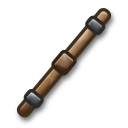 | Quarterstaff | Wide sweep · reach 2.7 m · 10 damage · 2.1/s · knocks back 0.9 m | south-centre (-22, 38) |
|  | Leech blade | Sweep · reach 2.1 m · 14 damage · 1.5/s · heals you for 35% of damage | north-east (55, -60) |
| 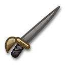 | Duelist sabre | Sweep · reach 2.4 m · 16 damage · 1.8/s · ×1.45 against heroes | south-centre (-3.5, 59) |

## Boots (20)

| | Item | Effect | Found |
| --- | --- | --- | --- |
|  | Springheel boots | Evade distance +1.6 m | mid-west (-48, 12) |
|  | Softsole boots | Sneak at 70% of running speed | mid-west (-58, 12.5) |
|  | Catspaw boots | Noise −50% | mid-east (50, 12) |
| 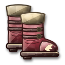 | Courier boots | Running speed +10% | north-centre (30, -30) |
| 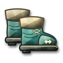 | Tumbler boots | Evade recovery −65% | north-east (60, -40) |
|  | Mistwalker boots | Unseen for 1.5 s after Evade | north-centre (-29.5, -25) |
|  | Bramble boots | Evade deals 10 damage to enemies beside you | south-west (-57, 30) |
|  | Pilgrim sandals | Evade restores 5 health | south-east (82.5, 24) |
| 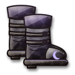 | Shadowstep boots | Noticed −55% as fast while sneaking | north-centre (5, -52) |
|  | Lastlegs boots | Speed +30% below 40% health | north-east (46, -26) |
| 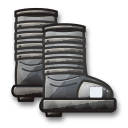 | Ironshod boots | Noise +30% · Cannot be shoved | south-west (-37.5, 51) |
| 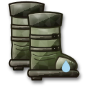 | Marsh waders | Cannot be slowed | mid-centre (-9.5, 16.5) |
| 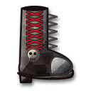 | Reaver boots | Haste for 4 s after a kill | north-centre (-8.5, -61) |
|  | Statue slippers | Noticed −65% as fast while standing still | south-centre (19, 38.5) |
|  | Ram boots | Evade shoves nearby enemies 2 m | mid-east (82, 4) |
|  | Bloodless greaves | Cannot be made to bleed | south-west (-87, 45.5) |
| 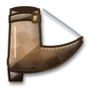 | Longstride boots | Running speed +5% · Evade distance +0.8 m | north-west (-64, -40) |
| 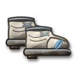 | Featherlight shoes | Running speed +5% · Noise −25% | north-east (61.5, -24.5) |
|  | Fencer boots | Evade recovery −40% · Evade distance +0.5 m | south-east (39.5, 52) |
| 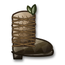 | Poacher boots | Noise −20% · Sneak at 60% of running speed | north-east (45.5, -45) |

## Charms (27)

| | Item | Effect | Found |
| --- | --- | --- | --- |
| 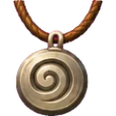 | Spiral charm | Salve healing +60% | mid-centre (-30, 12) |
|  | Ironbark charm | Maximum health +30 | south-centre (3, 37.5) |
|  | Thorn charm | Returns 5 damage to close attackers | north-west (-43.6, -54.6) |
|  | Dusk charm | Noticed −30% as fast | north-west (-52, -30) |
| 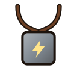 | Whetstone charm | Weapon damage +25% | north-centre (20, -20) |
| 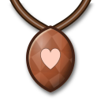 | Heartwood charm | Regain 1.5 health per second | mid-west (-85, -3) |
| 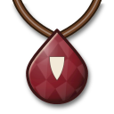 | Leech charm | Heal for 15% of damage dealt | south-east (69, 53) |
|  | Oakshield charm | Damage taken −20% | mid-centre (-16.5, 3.5) |
|  | Quickhand charm | Attack recovery −20% | south-west (-65.5, 53) |
|  | Songbird charm | Whistle recovery −60% | mid-east (69, -10) |
|  | Reaper charm | Heal 20 on a kill | south-west (-87.5, 31) |
|  | Warden charm | Ward mending +100% | south-east (52.5, 25) |
|  | Pilgrim token | Resurrection ritual −40% time | south-centre (-23.5, 23.5) |
|  | Samaritan charm | Reviving an ally −50% time | north-west (-86.5, -46.5) |
|  | Tinker charm | Item recovery −70% | north-west (-58, -51.5) |
| 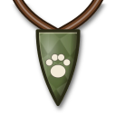 | Beastbane charm | Damage to monsters +40% | north-west (-45.5, -19) |
|  | Kingsbane charm | Damage to heroes +30% | north-west (-43.5, -39.5) |
|  | Glutton charm | Food healing +100% | south-centre (-9.5, 39) |
|  | Hourglass charm | Draughts last +100% | mid-centre (17.5, 16.5) |
|  | Phoenix feather | Return from death with +50 health | south-centre (26, 25.5) |
|  | Magpie charm | Collect finds from +150% distance | north-centre (-24, -60.5) |
|  | Forget-me-not charm | Monsters forget you +150% as fast | south-centre (4, 23.5) |
| 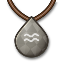 | Echo stone | Lures carry +60% | north-east (32, -18.5) |
|  | Fogglass charm | Smoke and veils last +100% | north-east (82, -53) |
|  | Longarm charm | Weapon reach +0.5 m | mid-centre (-7.5, -3) |
|  | Bully charm | Hits shove enemies 1 m | mid-west (-38, 4.5) |
|  | Last stand charm | Damage +60% below 30% health | north-east (74, -25.5) |

## Usable items (20)

| | Item | Effect | Found |
| --- | --- | --- | --- |
|  | Salve | Restores 30 health | mid-west (-66, 12.5) ×2 |
|  | Orchard apple | Restores 10 health | mid-west (-82, 13) ×2 |
|  | Cheese | Restores 18 health | mid-centre (6, 12) ×2 |
|  | Honeycake | Restores 45 health | south-west (-50, 38) ×2 |
|  | Bloodroot | Restores 70 health · slows you for 3 s | mid-east (33.5, 4) ×2 |
|  | Bandage | Restores 7 health per second for 6 s | mid-east (40.5, 16.5) ×2 |
|  | Smoke pot | Breaks pursuit within 12 m · unseen for 3 s | north-west (-66, -22) ×2 |
|  | Dusk veil | Unseen for 6 s · attacking ends it | north-centre (13.5, -46) ×2 |
| 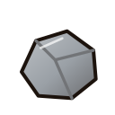 | Throwing stone | Noise 9 m ahead, heard 12 m from there | mid-west (-72, 11.5) ×3 |
|  | Firecracker | Noise 15 m ahead, heard 20 m from there | north-centre (25, -39) ×2 |
|  | Quickening draught | Speed +35% for 6 s | south-east (40, 36) ×2 |
|  | Iron draught | Damage taken −50% for 6 s | north-west (-71.5, -33) ×2 |
|  | Fury draught | Damage +50% for 6 s | north-centre (-30, -40) ×2 |
|  | Antidote | Ends bleed, slow and stun · immune for 8 s | south-centre (4.5, 53.5) ×2 |
| 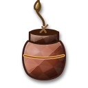 | Fire pot | 28 damage in a 3 m burst, 5 m ahead | south-east (62, 23) ×2 |
|  | Flash powder | Stuns enemies within 6 m for 2 s | north-east (34.5, -45.5) ×2 |
|  | Caltrops | Slows enemies within 4.5 m for 4 s | north-east (68, -54.5) ×2 |
| 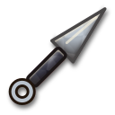 | Throwing knife | 22 damage to the first enemy within 8 m ahead | south-west (-65, 43.5) ×2 |
| 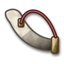 | War horn | You and allies within 14 m gain haste for 5 s | south-centre (-29.5, 46) ×2 |
|  | Blessed water | Removes 30% corruption from the wayshrine you stand in | north-centre (-2, -40) ×2 |

## Materials (6)

| | Item | Effect | Found |
| --- | --- | --- | --- |
|  | Lavender | Mends 35% of a wayshrine's wards | mid-west (-64, -2) ×3; north-centre (-12, -30) ×2 |
|  | White salt | Mends 70% of a wayshrine's wards | south-east (32.5, 58) ×3 |
|  | Ward scroll | Fully restores a wayshrine's wards | north-centre (-30, -50) |
|  | Beeswax candle | Purifying a wayshrine takes half the time | north-east (52.5, -32.5) ×3 |
| 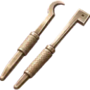 | Lockpicks | Sabotage the relay one second faster while carried | north-centre (10, -34) |
|  | Lucky coin | A killing blow leaves you at 1 health and spends a coin | mid-centre (30, 14) ×5 |
